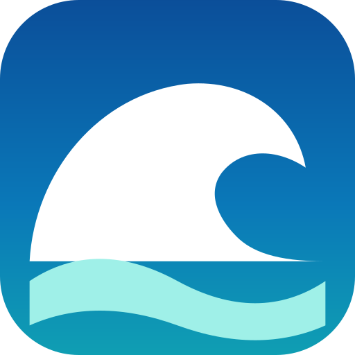
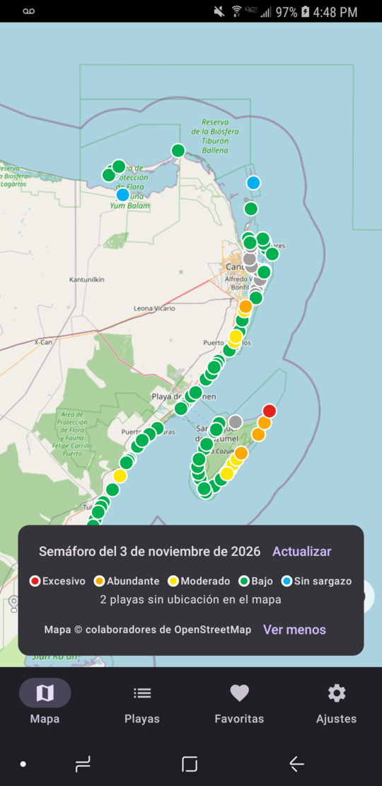
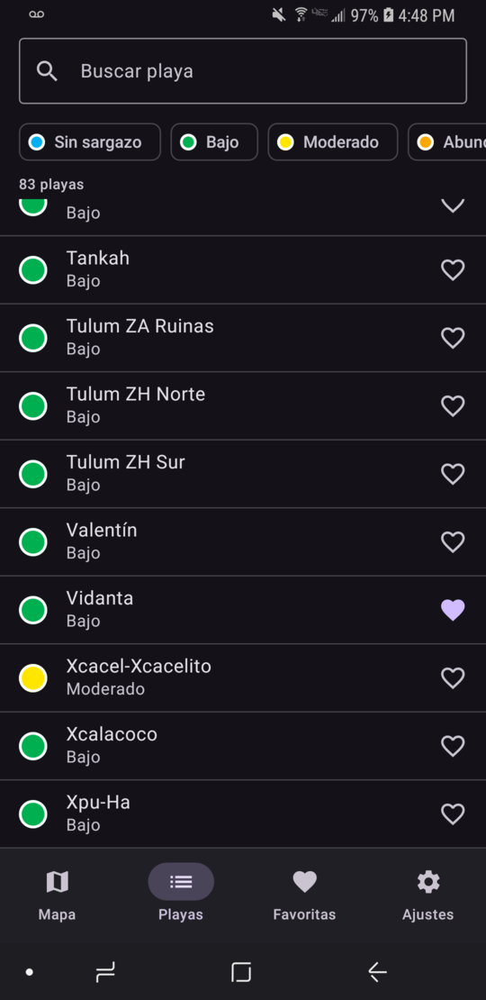
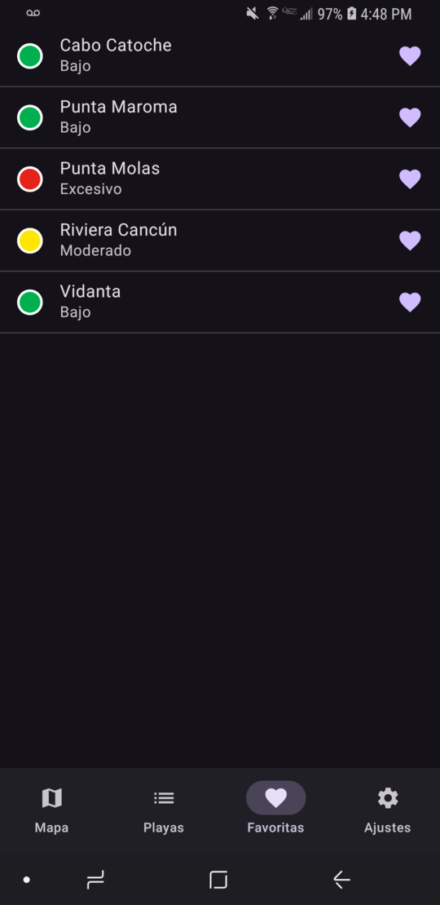
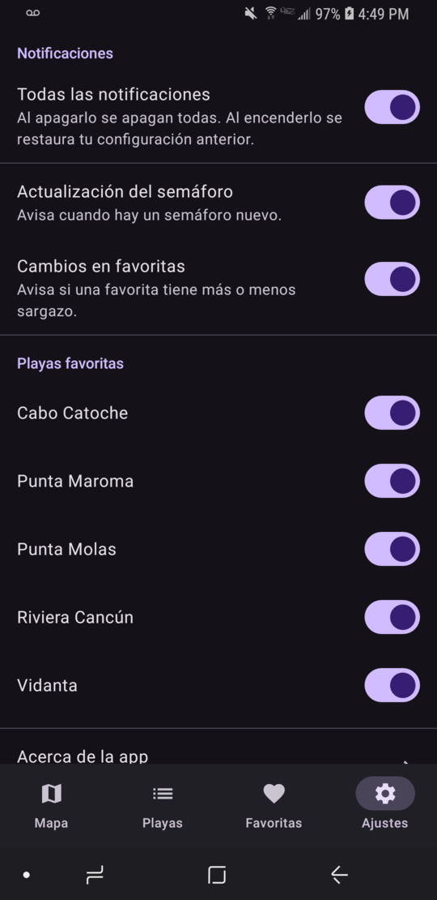
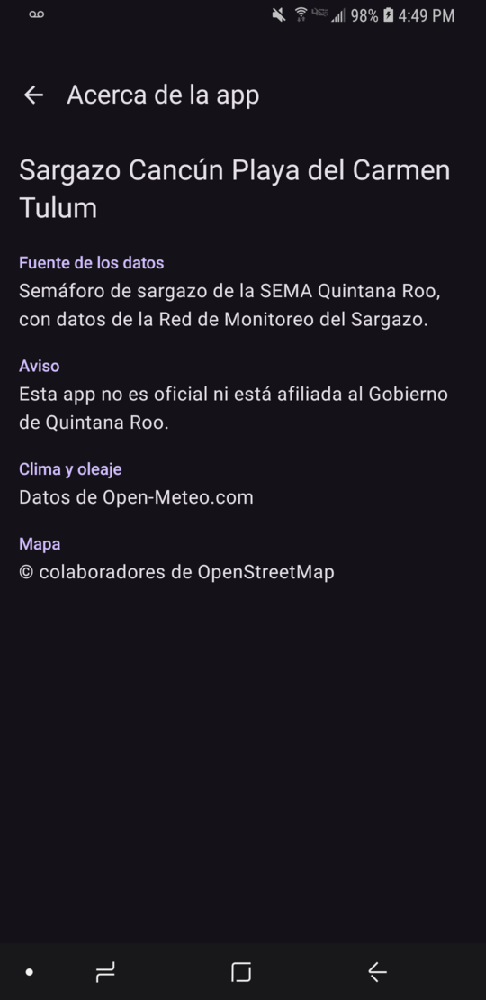

# Sargazo Cancún Playa del Carmen Tulum

An Android portfolio app that shows the official sargassum traffic light ("semáforo") of Quintana Roo, Mexico, on a map. Each beach is drawn with the color of its current sargassum level, and you can open a beach to see its level history, weather and sea conditions.

> **Unofficial app.** This app is not official and is not affiliated with the Government of Quintana Roo or the SEMA. The data comes from the official SEMA sargassum traffic light.

<p align="center">
  
</p>

<p align="center">
  
  
  
  
  
</p>

## Features

- **Map** of the Cancún–Tulum coast (and Cozumel), with one colored circle per beach. The camera stays within the beach area and the zoom is limited to keep the map light. Uses OpenStreetMap tiles.
- **Beach detail**: current level, date of the latest update, level history, and weather and sea conditions.
- **Beach list** with search and filter by color.
- **Favorites**, with the current level of each one.
- **Notifications** (WorkManager checks for a new traffic light every 6 hours):
  - a general alert when a new traffic light is published;
  - an alert when a favorite beach goes up or down in sargassum level, grouped in one notification.
- **Settings**: a general switch for all notifications, one switch per notification type, and one switch per favorite beach. Turning the general switch back on restores your previous choices.
- **About the app** (from Settings): the data source, a notice that the app is not official, and the credits for Open-Meteo and OpenStreetMap.
- **Offline use**: the last published data is stored in a local database, so the app works without internet.
- **Level history** is kept for two months. Favorites and settings are never deleted.

## How the data gets into the app

The sargassum traffic light is published by the SEMA on its official social media. Those platforms do not allow automatic downloads, so the data is published like this:

1. An administrator signs in with a Google account to a hidden admin screen and uploads the official image.
2. The app reads the beach names with ML Kit text recognition and reads each beach's color from the image.
3. The colors are converted to levels: green (scarce), yellow (moderate), orange (high), red (very high), and blue (no data).
4. The administrator reviews and corrects the levels, then publishes them to Cloud Firestore. **Only the levels are published, not the image.**
5. Every app reads Firestore and stores a copy in Room.

Firestore security rules allow anyone to read, but only the administrator's account can write. The hidden screen is not a security measure; the rules are.

**Data source:** semáforo de sargazo published by the SEMA Quintana Roo, with data from the Red de Monitoreo del Sargazo. Weather and sea conditions come from [Open-Meteo](https://open-meteo.com/). The app shows this information on its About screen.

## Tech stack

- Kotlin, Jetpack Compose, Material 3 (light and dark themes, dynamic colors)
- MVVM with `data`, `domain` and `ui` layers
- Hilt for dependency injection
- Room (with KSP) for the local database
- Coroutines and Flow, with `StateFlow` in ViewModels
- Navigation Compose with typed routes
- MapLibre Compose with OpenStreetMap tiles (no API key needed)
- Retrofit, OkHttp and Kotlinx Serialization for the Open-Meteo API
- ML Kit Text Recognition
- WorkManager for background checks and cleanup
- Coil for images
- Firebase Authentication (Google account, administrator only) and Cloud Firestore
- JUnit and Turbine for unit tests

Requires Android 8.0 (API 26) or higher.

## Build and run

1. Clone the repository and open it in Android Studio.
2. Create a Firebase project and add an Android app with the package name `victor.android.sargazocancnplayadelcarmentulum`.
3. Download `google-services.json` and place it in `app/`. It is not in this repository because it is project-specific configuration. The file is listed in `.gitignore`.
4. Enable the Google sign-in provider in Firebase Authentication, add your app's SHA-1 fingerprint, and deploy `firestore.rules`.
5. Run `./gradlew assembleDebug` or press **Run** in Android Studio.

To run the unit tests, use `./gradlew test`.

No API keys are needed for the map or for Open-Meteo.

## Project structure

```
app/src/main/java/.../
├── data/        Room, Firestore, Retrofit, ML Kit, WorkManager and repository implementations
├── domain/      Models, repository interfaces and business rules (traffic-light color reading, notifications)
└── ui/          Compose screens, ViewModels and UI states
docs/            App icon and screenshots
```

## Privacy and security

- The repository contains no API keys, passwords or personal data. Firebase configuration is kept out of version control.
- The administrator signs in with Firebase Authentication using a Google account. The administrator's UID is added by hand in the Firebase console, and the app does not allow sign-up.
- The app asks for internet access and, on Android 13 or higher, permission to show notifications.

## Credits

- Map data © [OpenStreetMap](https://www.openstreetmap.org/copyright) contributors.
- Sargassum levels: semáforo de sargazo, SEMA Quintana Roo.
- Weather and sea data: [Open-Meteo](https://open-meteo.com/).
